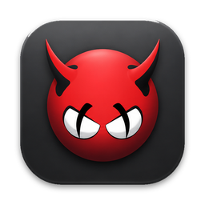
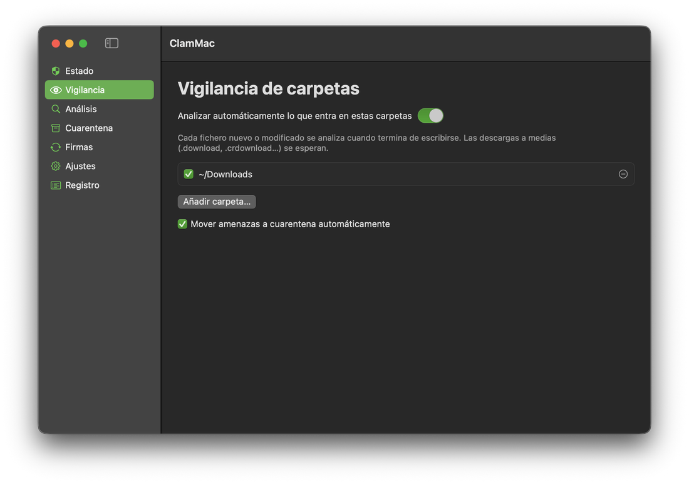

# ClamMac

[](https://angelbonet.github.io/ClamMac/)
[](https://github.com/angelbonet/ClamMac/releases/latest)
[](#requisitos)
[](LICENSE)

Antivirus para Mac basado en **ClamAV**, con interfaz nativa en la barra de menú. Vigila las carpetas que elijas (por defecto **Descargas**) y analiza todo lo que entra, mantiene al día la biblioteca de amenazas —de forma automática o manual—, aparta lo infectado a cuarentena y se actualiza a sí mismo con un clic.

Es el equivalente para macOS de [ClamGuard](https://github.com/angelbonet/ClamGuard) (Windows): una interfaz gráfica sencilla sobre el motor libre ClamAV, pensada para que cualquiera pueda usarla sin tocar la terminal.

**[📖 Documentación completa](https://angelbonet.github.io/ClamMac/)**

<p align="center"></p>



## Características

- **Vigilancia de carpetas** en tiempo real (FSEvents): analiza cada fichero nuevo o modificado **cuando termina de escribirse**, sin tocar las descargas a medias (`.download`, `.crdownload`…)
- **Biblioteca de amenazas actualizable**: automática (cada 1, 4, 12 horas, diaria o semanal) o solo cuando tú quieras, con botón «Actualizar ahora»
- **Análisis** rápido (Descargas, Escritorio, Documentos), de una carpeta concreta o **programado** por día y hora
- **Cuarentena**: lo detectado se aparta automáticamente; puedes *restaurar* (falsos positivos) o *eliminar*
- **Análisis instantáneo** con un `clamd` propio (opcional, ~1 GB de RAM)
- **Avisos**: notificaciones del sistema y, opcionalmente, **Pushover** (el token se guarda en el llavero)
- **Actualización de la app con un clic**: se descarga desde GitHub, se verifica (SHA-256, firma y notarización), se cierra, se sustituye y se vuelve a abrir sola; si algo falla restaura la versión anterior
- **Firmada y notarizada por Apple**: se abre con doble clic, sin avisos de Gatekeeper
- **Aviso de permisos**: detecta cuándo falta el *Acceso total al disco* y lo dice claramente

## Requisitos

| Componente | Descripción | Enlace |
|------------|-------------|--------|
| macOS 14 (Sonoma) o superior | Sistema operativo | — |
| Mac con **Apple Silicon** (M1 o posterior) | La versión actual es solo `arm64`; la de Intel está pendiente | — |
| ClamAV | Motor antivirus (ClamMac **no lo incluye**, usa el de Homebrew) | `brew install clamav` · [clamav.net](https://www.clamav.net/) |
| Conexión a Internet | Para descargar firmas y buscar versiones nuevas | — |

## Instalación

1. Descarga `ClamMac-x.y.z.dmg` de [Releases](../../releases/latest)
2. Ábrelo y **arrastra ClamMac a Aplicaciones** (el DMG incluye un `Léeme.html` con los pasos)
3. Abre ClamMac: aparece un **escudo en la barra de menú**
4. Concede el permiso de **Acceso total al disco** (imprescindible, ver abajo)

> ⚠️ **Acceso total al disco**: sin este permiso macOS impide a ClamMac leer carpetas como Descargas, Escritorio o Documentos **y se salta ficheros sin avisar**. Ajustes del Sistema › Privacidad y seguridad › Acceso total al disco › activa **ClamMac** (o pulsa `+` y añádela). Pasos con detalle en [la guía de permisos](https://angelbonet.github.io/ClamMac/guia/permisos/). Si falta, ClamMac muestra un aviso naranja en la pantalla *Estado*.

## Actualizaciones

- **Firmas (biblioteca de amenazas)**: *Firmas › Automática / Manual* y frecuencia. Usan `freshclam` (servidores oficiales de ClamAV).
- **La propia app**: busca una versión nueva en GitHub una vez al día (se desactiva en *Ajustes*). Cuando hay una, pulsa **Actualizar y reiniciar**.

## Documentación

| Guía | Descripción |
|------|-------------|
| [📦 Instalación](https://angelbonet.github.io/ClamMac/guia/instalacion/) | Instalar paso a paso, con ClamAV |
| [🔐 Permisos](https://angelbonet.github.io/ClamMac/guia/permisos/) | Acceso total al disco y notificaciones |
| [📖 Uso](https://angelbonet.github.io/ClamMac/guia/uso/) | Vigilancia, análisis, cuarentena, firmas y ajustes |
| [🔄 Actualizaciones](https://angelbonet.github.io/ClamMac/guia/actualizaciones/) | Firmas y actualización de la app |
| [🛡️ Seguridad y privacidad](https://angelbonet.github.io/ClamMac/guia/seguridad/) | Qué hace, qué no hace y qué datos usa |
| [🧰 Problemas frecuentes](https://angelbonet.github.io/ClamMac/guia/problemas/) | Solución de problemas y desinstalación |
| [🛠️ Desarrollo](https://angelbonet.github.io/ClamMac/desarrollo/compilar/) | Compilar, firmar, notarizar y publicar |

## Desarrollo

```bash
git clone https://github.com/angelbonet/ClamMac.git
cd ClamMac

swift test                    # tests (incluye detección EICAR real con tu ClamAV)
./build_app.sh --install      # compila, firma e instala en /Applications
./build_dmg.sh                # DMG firmado y notarizado
./release.sh "Notas"          # publica la release en GitHub con el DMG y su SHA-256
```

Los scripts firman con el certificado de INNOVAORTO AIE; para compilar tu propia copia cambia `SIGN_HASH` y `NOTARY_PROFILE` (ver [Desarrollo](https://angelbonet.github.io/ClamMac/desarrollo/compilar/)).

## Documentación con MkDocs

```bash
pip install mkdocs-material
mkdocs serve
```

## Créditos y licencia

Código bajo **licencia MIT** (ver [LICENSE](LICENSE)). Idea inspirada en [ClamGuard](https://github.com/angelbonet/ClamGuard) para Windows.

ClamAV® y su mascota son marcas de Cisco Systems. ClamMac es un proyecto independiente, sin relación con Cisco ni con Apple, que solo es una interfaz para el ClamAV que tienes instalado. Los iconos derivan de la mascota de ClamAV y **no** están cubiertos por la licencia MIT.

---

**abDatabase** · [abdatabase.com](https://abdatabase.com) · [☕ Invita un café](https://buymeacoffee.com/angelbonet)
