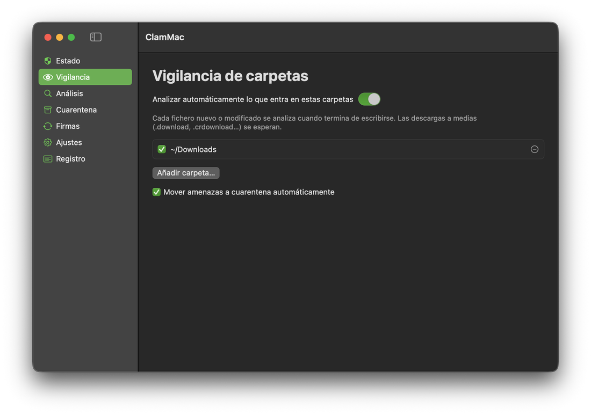
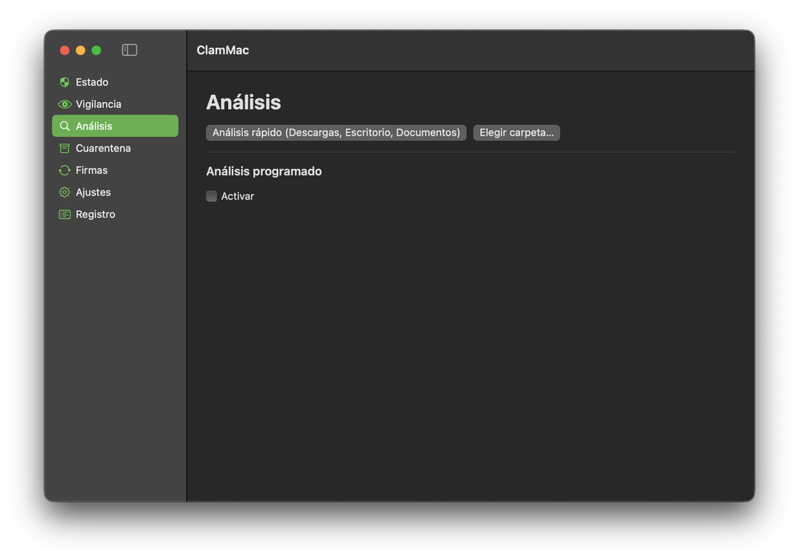
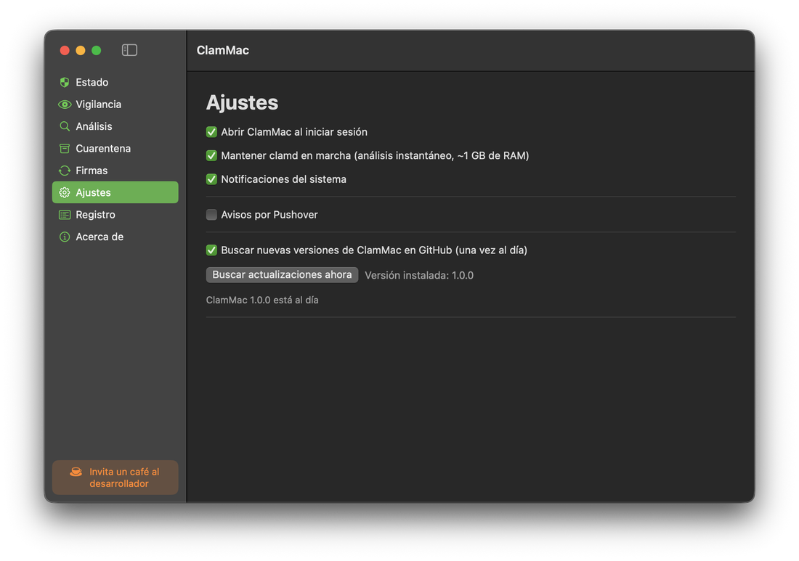
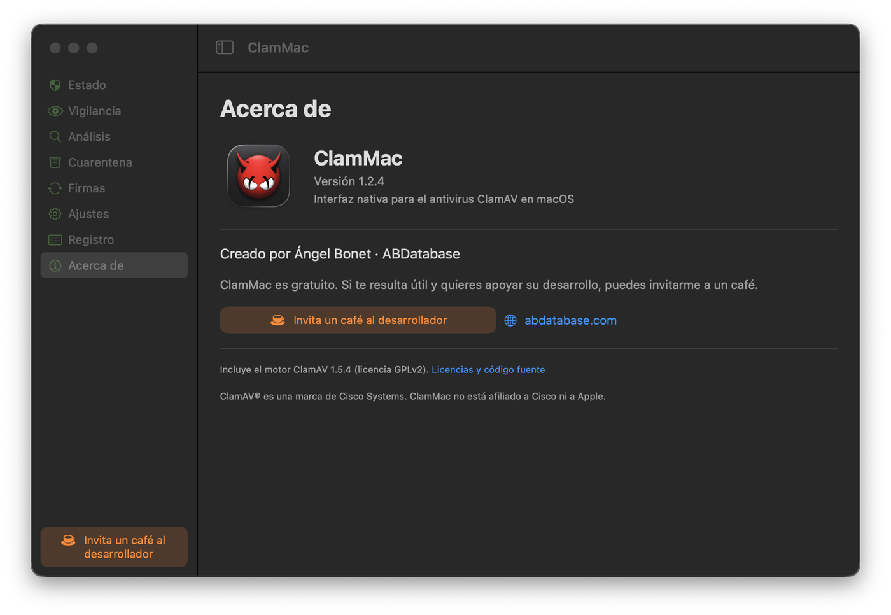

# Uso

ClamMac vive en la **barra de menú** (icono de escudo). Al abrir su ventana aparece también en el Dock; al cerrarla, vuelve a quedarse solo en la barra y **sigue protegiendo**.

El menú del escudo permite activar/desactivar la vigilancia, lanzar un análisis rápido, actualizar firmas y abrir la ventana.

## Estado

Resume la protección: vigilancia, motor, versión de firmas, modo de actualización y elementos en cuarentena. Incluye el botón **Probar protección** ([más info](prueba.md)). Aquí aparecen los avisos importantes (falta de ClamAV, falta de *Acceso total al disco*, versión nueva de la app).

## Vigilancia de carpetas

- Activa o desactiva la vigilancia con el interruptor general.
- Añade carpetas con **Añadir carpeta…**; cada una se puede activar o quitar por separado. **Descargas** viene por defecto.
- Cada fichero **nuevo o modificado** se analiza **cuando termina de escribirse** (se espera a que su tamaño y fecha dejen de cambiar). Así no se analizan descargas a medias.
- Se ignoran los temporales (`.download`, `.crdownload`, `.part`, `.partial`, `.tmp`) y `.DS_Store`.
- *Mover amenazas a cuarentena automáticamente*: si lo desactivas, solo se avisa y el fichero se queda donde está.

## Análisis

- **Análisis rápido**: Descargas, Escritorio y Documentos.
- **Elegir carpeta…**: analiza una carpeta concreta.
- **Análisis programado**: elige día de la semana y hora. Antes de analizar actualiza las firmas.

El resultado muestra cuántos ficheros se analizaron, las amenazas y, si faltó el permiso, cuántos ficheros no se pudieron leer.

## Cuarentena

Lo detectado se **aparta** a una carpeta propia de ClamMac y se le quitan todos los permisos. Desde la pantalla *Cuarentena*:

- **Restaurar**: lo devuelve a su sitio original (si ya hay algo allí, añade «(restaurado)» al nombre). Úsalo si es un **falso positivo**.
- **Eliminar**: lo borra definitivamente.

## Firmas

Ver [Actualizaciones](actualizaciones.md).

## Ajustes

- *Abrir ClamMac al iniciar sesión*.
- *Idioma*: **Automático** (sigue el idioma del Mac) o **Español, Català, English, Français, Deutsch**. El cambio se aplica al reiniciar ClamMac (botón *Reiniciar ahora*). Si el idioma de tu Mac no está entre estos cinco, ClamMac se muestra en español.
- *Mantener clamd en marcha*: análisis casi instantáneo a cambio de ~1 GB de RAM. Si lo desactivas, cada análisis carga las firmas desde cero (unos segundos más).
- *Notificaciones del sistema* y **Pushover** (opcional).
- *Buscar nuevas versiones de ClamMac en GitHub*.

### Pushover (opcional)

Para recibir avisos en el móvil: activa *Avisos por Pushover* y rellena tu **User key** y el **App token** (se guarda en el **llavero** de macOS, no en un fichero).

## Registro

La pantalla *Registro* lista lo ocurrido (análisis, amenazas, actualizaciones). También se guarda en un fichero (ver [Seguridad y privacidad](seguridad.md)).

## Acerca de

Versión, autor y el botón para **invitar un café al desarrollador** ☕.
