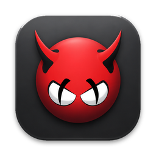
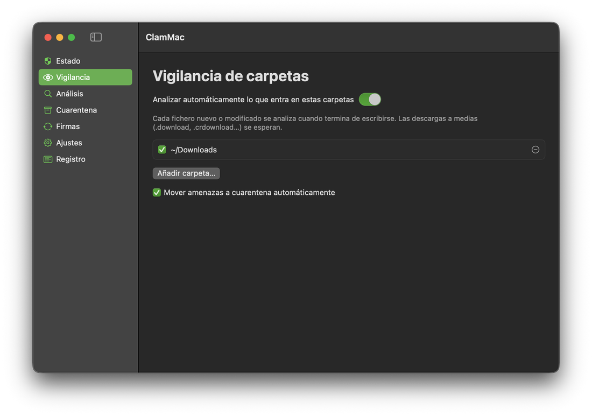

# ClamMac

{ width="120" align=right }

**Antivirus para Mac basado en ClamAV**, con interfaz nativa en la barra de menú.

ClamMac vigila las carpetas que elijas —por defecto **Descargas**— y analiza todo lo que entra, mantiene al día la biblioteca de amenazas (de forma automática o manual), aparta lo infectado a cuarentena y se actualiza a sí mismo con un clic.

Es el equivalente para macOS de [ClamGuard](https://github.com/angelbonet/ClamGuard) (Windows): una interfaz gráfica sencilla sobre el motor libre **ClamAV**, para usarlo sin tocar la terminal.

## Qué ofrece

- **Vigilancia de carpetas** en tiempo real: analiza cada fichero nuevo cuando termina de escribirse.
- **Biblioteca de amenazas** actualizable automática o manualmente.
- **Análisis** rápido, de una carpeta o programado.
- **Cuarentena** con restaurar y eliminar.
- **Avisos** del sistema y por Pushover.
- **Actualización de la app con un clic**.
- **Firmada y notarizada por Apple**: se abre sin avisos.

## Para empezar

1. [Instala ClamAV y ClamMac](guia/instalacion.md).
2. [Concede el Acceso total al disco](guia/permisos.md) — **imprescindible**.
3. Mira cómo se [usa](guia/uso.md).

!!! warning "Sin «Acceso total al disco» no protege de verdad"
    macOS impide en silencio que las apps lean carpetas como Descargas, Escritorio o Documentos. Sin este permiso, ClamMac se saltaría ficheros sin avisarte. Solo hay que concederlo una vez: [cómo hacerlo](guia/permisos.md).

## Requisitos

- macOS 14 (Sonoma) o superior
- Mac con **Apple Silicon o Intel** (binario universal)
- ClamAV: `brew install clamav`

---

**abDatabase** · [abdatabase.com](https://abdatabase.com) · [☕ Invita un café](https://buymeacoffee.com/angelbonet)
